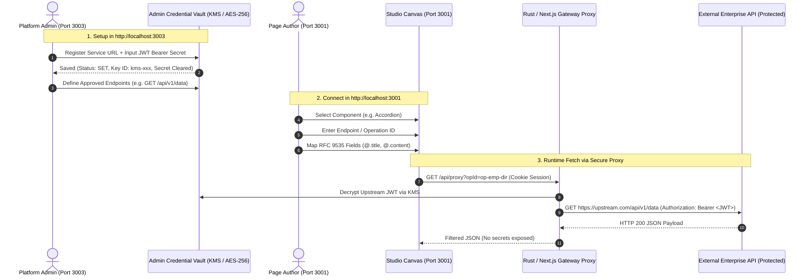

# Upstream Authenticated Services (JWT / Bearer) Configuration Guide
## Enterprise Visual Website Development Platform

- **Applies to:** Prototype 1 (Port 3001), Prototype 2 (Port 3002), Prototype 3 (Port 3003)
- **Security Standard:** `docs/security-model.md` (SSRF Prevention, Envelope Encryption, Dual-Identity Realms)

---

## 1. Quick Answer: Which Port & Where?

| Service | Port | Role in Authenticated APIs |
| :--- | :--- | :--- |
| **Admin & Security Gateway** | **`http://localhost:3003/`** | **PRIMARY LOCATION FOR AUTH CONFIGURATION.** Configure upstream service URLs, authentication schemes (Bearer/JWT, OAuth 2.0, API Keys), write-only credential vaults, KMS envelope encryption, and approved operations. |
| **Data-Binding Matrix** | `http://localhost:3002/` | **DATA PATH VALIDATION.** Evaluates RFC 9535 expressions (`$.data`, `@.item`) against mock/sample responses. It **does not store security secrets**. |
| **Studio Canvas** | `http://localhost:3001/` | **CONSUMER & COMPONENT MAPPING.** Page authors select registered operations (`op-id`) and map response fields (`@.title`) into component slots without ever exposing secrets to the browser. |

> [!IMPORTANT]
> **Zero Trust Rule (Browser vs Gateway):**
> Visual Studio canvas (`localhost:3001`) must **NEVER** handle raw upstream JWTs, bearer tokens, private keys, or credentials directly in client-side state. All upstream requests are routed through the backend proxy gateway which transparently attaches vaulted JWT credentials.

---

## 2. End-to-End Workflow: Configuring a JWT-Protected Service



---

## 3. Step-by-Step Instructions

### Step 1: Configure Upstream Service & JWT in Admin Gateway (`http://localhost:3003/`)

1. Start Prototype 3:
   ```powershell
   pnpm --filter prototype-3-admin dev
   ```
2. Open **`http://localhost:3003/`** in your browser.
3. In the left navigation sidebar, select **API Registry & Vault** (`activeTab = 'apis'`).
4. Select or add your upstream API service:
   - **Name:** `ERP Procurement & Invoices` (or your service name)
   - **Base URL:** `https://erp-upstream.internal.enterprise.com`
   - **Authentication Scheme:** `Bearer Token` (or `OAuth 2.0 Client Credentials` / `API Key`)
5. Click **Rotate Credential** (or Add Credential):
   - Enter your **JWT Token** or secret string into the write-only input.
   - Click **Save / Rotate**.
   - The UI immediately writes the secret to envelope encryption (AES-256-GCM + KMS Data Encryption Key) and clears the input buffer.
   - The UI displays:
     ```
     Status: SET
     KMS Key: kms-key-erp-prod-02
     Last Rotated: [Current Timestamp]
     ```
6. Register the **Approved Endpoints / Operations**:
   - Method: `GET` / `POST`
   - Path: `/api/v2/orders` (or `/api/accordion-items`)
   - Required RBAC Permission: `orders.read` (or `public` / tenant claim)

---

### Step 2: Validate Data Structure in Data-Binding Matrix (`http://localhost:3002/`)

1. If you need to test JSONPath parsing on complex, deeply nested JSON responses before wiring to UI components:
   ```powershell
   pnpm --filter prototype-2-data-mapping dev
   ```
2. Navigate to **`http://localhost:3002/`**.
3. Paste a sample payload of your API's authenticated response.
4. Verify your RFC 9535 expressions:
   - Root Collection: `$.data` or `$.items`
   - Item Field Slots: `@.id`, `@.title`, `@.content`, `@.icon`

---

### Step 3: Wire into Studio Components (`http://localhost:3001/`)

1. In the Studio Canvas (`http://localhost:3001/`):
2. Select your component (e.g. **Accordion** or **Table**).
3. In the right **Component Inspector**:
   - Toggle **Data Source** to **API Endpoint**.
   - Input the registered endpoint route (e.g. `/api/accordion-items` or gateway proxy route `/api/proxy/orders`).
   - Click **Fetch API Data Now**.
   - In the **Field Mapping (`@.path`)** section:
     - Click the detected pill tags (e.g. `@.title`, `@.content`, `@.id`) or type your custom paths.
4. When the user or previewer accesses the page, the internal server proxy forwards the request with the vaulted JWT header `Authorization: Bearer <TOKEN>` to the upstream host, keeping secrets 100% confidential.

---

## 4. Key Architectural & Security Rules

1. **Write-Only Principle:** Neither developers in Studio nor site visitors can inspect or read the raw JWT string via any API.
2. **Dual-Identity Segregation:**
   - **Builder Identity:** Studio admins and developers logged into the platform via Keycloak (`platform-management` realm).
   - **Site-Visitor Identity:** End-users viewing published websites via tenant realms (`project-visitors` realm).
3. **SSRF Guardrails:** All proxy requests to upstream URLs are verified through `hickory-resolver` custom DNS resolution to prevent localhost loops (`127.0.0.1`), private RFC 1918 probing, or cloud metadata theft (`169.254.169.254`).
